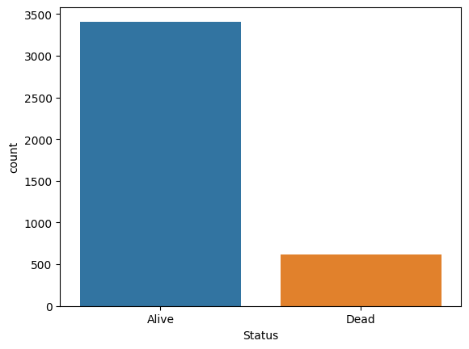
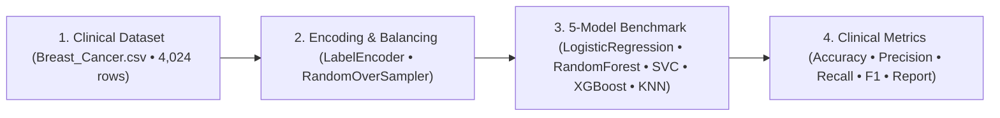

# Breast Cancer Prediction (`Breast-Cancer-prediction`) — Imbalanced Clinical Classification Benchmark

## Table of Contents
- [Executive Summary & Business Utility](#executive-summary--business-utility)
- [Visual Showcase (UI & Dashboards)](#visual-showcase-ui--dashboards)
- [System Architecture & Layers](#system-architecture--layers)
- [Data Model & Clinical Schema](#data-model--clinical-schema)
- [Model Pipeline & Benchmarks](#model-pipeline--benchmarks)
- [Getting Started](#getting-started)
- [Business Value, ROI & Growth Opportunities](#business-value-roi--growth-opportunities)

---

## Executive Summary & Business Utility
`Breast-Cancer-prediction` is a 22-cell healthcare machine learning project (`breast-cancer-predict.ipynb`) trained on **4,024 clinical oncology records** (`Breast_Cancer.csv`). Because false negatives in cancer prognosis/status prediction are unacceptable, the pipeline applies **Random Oversampling (`imblearn.over_sampling.RandomOverSampler`)** to neutralize class imbalance and benchmarks **5 classifiers** across accuracy, precision, recall, and F1-score.

---

## Visual Showcase (UI & Dashboards)
Exploratory & clinical visualization extracted from `breast-cancer-predict.ipynb`:



---

## System Architecture & Layers


| Layer | Tools & Libraries |
| :--- | :--- |
| **Preprocessing & Class Balancing** | `pandas`, `numpy`, `LabelEncoder`, `imblearn.over_sampling.RandomOverSampler`, `train_test_split` |
| **Visualization** | `matplotlib.pyplot`, `seaborn` |
| **Benchmarked Models** | `LogisticRegression`, `RandomForestClassifier`, `SVC`, `XGBClassifier`, `KNeighborsClassifier` |
| **Evaluation** | `accuracy_score`, `precision_score`, `recall_score`, `f1_score`, `classification_report` |

---

## Data Model & Clinical Schema
- **Dataset**: `Breast_Cancer.csv` (**4,024 patient records**)
- **Columns (16)**: `Age`, `Race`, `Marital Status`, `T Stage `, `N Stage`, `6th Stage`, `differentiate`, `Grade`, `A Stage`, `Tumor Size`, `Estrogen Status`, `Progesterone Status`, `Regional Node Examined`, `Reginol Node Positive`, `Survival Months`, `Status`

---

## Getting Started
```bash
git clone https://github.com/islamsamyy/Breast-Cancer-prediction.git
cd Breast-Cancer-prediction
jupyter notebook breast-cancer-predict.ipynb
```

---

## Business Value, ROI & Growth Opportunities
- **High-Recall Clinical Triage Support**: Prioritizes minority positive cases via oversampling to minimize missed high-risk patients (for research/decision-support workflows).
- **Explainable AI (SHAP) Upgrade**: Adding SHAP waterfall plots makes tumor stage, node positivity, and hormone-receptor contributions transparent to oncology researchers.
