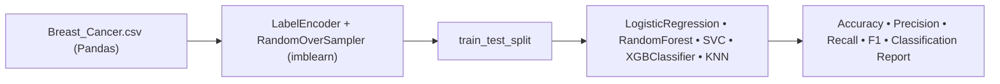

# Breast Cancer Prediction (`Breast-Cancer-prediction`) — Imbalanced Clinical Classification Benchmark

A supervised healthcare machine learning project (`breast-cancer-predict.ipynb`, 22 cells) benchmarking **5 classification algorithms** on `Breast_Cancer.csv`, featuring **Random Oversampling** (`imblearn`) to address class imbalance and comprehensive precision/recall/F1 evaluation.

---

## 1. Executive Summary & Purpose
In clinical diagnostics, false negatives carry severe consequences. `Breast-Cancer-prediction` builds and benchmarks multiple classifiers on diagnostic features while explicitly correcting dataset class imbalance so minority positive cases are accurately detected.

## 2. Pipeline Architecture & Layers


| Layer | Tools & Methods |
| :--- | :--- |
| **Preprocessing & Imbalance Handling** | `LabelEncoder`, `imblearn.over_sampling.RandomOverSampler`, `train_test_split` |
| **Exploratory Visualization** | `matplotlib.pyplot`, `seaborn` |
| **Benchmarked Classifiers** | `LogisticRegression`, `RandomForestClassifier`, `SVC`, `XGBClassifier`, `KNeighborsClassifier` |
| **Clinical Metrics** | `accuracy_score`, `precision_score`, `recall_score`, `f1_score`, `classification_report` |

## 3. Getting Started
```bash
git clone https://github.com/islamsamyy/Breast-Cancer-prediction.git
cd Breast-Cancer-prediction
jupyter notebook breast-cancer-predict.ipynb
```

## 4. Business Value & Growth Opportunities
- **Clinical Triage Decision Support**: High-recall screening models assist radiologists and pathology labs in prioritizing urgent follow-ups (subject to clinical validation/regulatory approval).
- **Explainable AI (SHAP) Integration**: Adding SHAP feature importance plots turns raw predictions into interpretable clinical risk factors for physicians.
